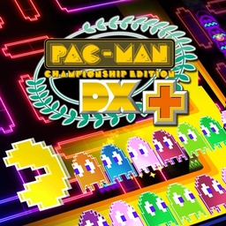

<h1 align=center>PAC-MAN Championship Edition DX+: Nintendo Switch port</h1>

<b>pacman-nx 1.0.0</b> · <a href="https://chanseyisthebest.github.io/pacman-nx-installer/">web installer</a> · <a href="https://github.com/ChanseyIsTheBest/pacman-nx/releases/tag/v1.0.0">release</a>

An unofficial native port of the Xbox 360 version of **PAC-MAN Championship Edition DX+** (Namco Bandai Games, 2010,
with its Title Update 3 of 2013) and its DLC, made by static recompilation with
[ReXGlue](https://github.com/rexglue/rexglue-sdk). No emulator.

This repository contains no game files. You need your own copy of the game: the Xbox 360 package
(`Content/<profile>/58410A8C/000D0000`) **and its Title Update 3** (`Content/0000000000000000/58410A8C/000B0000`); the
All-in-One Pack DLC (`Content/<profile>/58410A8C/00000002`) is optional.

## Playing it on the Switch

1. Open the web installer: **https://chanseyisthebest.github.io/pacman-nx-installer/**
2. Add your game, Title Update 3 and the DLC if you have it (package files or extracted folders) and press
   **Create pacman-nx.zip**. Everything runs in your browser; your game files never leave your computer.
3. Extract `pacman-nx.zip` into `sdmc:/switch/`.
4. Start it with a game override (hold **R** while starting an installed title) or a forwarder.

To update, add your game and Title Update 3 on the same page, press **Create pacman-nx-update.zip** and extract it over
your folder. Your `pacman.toml`, saves and game files stay. An install made before the title update needs this too.

- A forwarder must be set to a **39-bit address space**. Album applet mode does not give the game enough memory.
- With the DLC, the first start takes longer (about 45 s): the game installs it then, once.
- The first time you play after installing or updating, the game compiles its shaders as it meets them, so it can
  stutter for a moment on new screens. Later sessions are smooth.

## Features

- Title Update 3's game, with the All-in-One Pack DLC (the original game cannot use it).
- 720 lines in handheld and 1080 docked, at the console's stock clocks; gameplay holds 60 fps.
- reNut's Direct3D-level renderer (as the Banjo-Kazooie: Nuts & Bolts port adapted it) on deko3d, the Switch GPU's own
  API.
- Low input lag: as in [futari-nx](https://github.com/ChanseyIsTheBest/futari-nx), each frame starts from the display's
  refresh, with two swapchain images.
- The game's shaders are made from your copy by the installer.
- No log files are written.

`pacman.toml`, next to the NRO, holds your options (delete it to get the defaults back): `language` (`"auto"` follows
the Switch; or `english`, `japanese`, `french`, `german`, `spanish`, `italian`, `schinese`, `tchinese`),
`input_xbox_layout` (face buttons by position as on the Xbox pad, B being the Xbox's A; `false` = by letter),
`input_joycon_sideways` and `input_joycon_sideways_stick` (single Joy-Cons held sideways, one per player), and
`[input_p1]` (button mapping, e.g. `a = "B, ZR"`).

## Building

Needs Windows with LLVM clang and the VS Build Tools (PC build); devkitA64, libnx and deko3d from
[devkitPro](https://devkitpro.org) (Switch); Python; and your own copy of the game (for the code generator and the
shaders). All steps are in [docs/building.md](docs/building.md).

More: [docs/pacman-notes.md](docs/pacman-notes.md) (the port step by step),
[docs/optimising-functions.md](docs/optimising-functions.md), [docs/progress-log.md](docs/progress-log.md).

## Credits and license

- **Namco Bandai Games**: creators of PAC-MAN Championship Edition DX+.
- **ChanseyIsTheBest**: this port.
- **[Tom Clay](https://github.com/rexglue/rexglue-sdk)**: the ReXGlue SDK, built on the work of the
  **[Xenia](https://xenia.jp)** team.
- **[StevensND](https://github.com/StevensND/nfsmw-nx)**: nfsmw-nx (the SDK's Switch layer, much of the method) and
  [nfsmw-nx-installer](https://github.com/StevensND/nfsmw-nx-installer), which the installer page is built on.
- **[nebadasSwifty](https://github.com/nebadasSwifty/masseffect-nx)**: masseffect-nx.
- **[hedge-dev](https://github.com/hedge-dev/XenosRecomp)**: XenosRecomp, the Xenos shader translator.
- **reNut and [masterspike52](https://github.com/masterspike52/reNut)**: reNut's Direct3D-level renderer (reused with its
  author's permission); banjo-nx's shader passes.
- **[plume](https://github.com/renderbag/plume)** (from UnleashedRecomp), **[deko3d](https://github.com/devkitPro/deko3d)**
  and **[uam](https://github.com/devkitPro/uam)** by fincs, with SwitchWakerHD's uam patches.
- **[devkitPro](https://devkitpro.org) and [switchbrew](https://github.com/switchbrew/libnx)**: devkitA64 and libnx.
- **[KhronosGroup](https://github.com/KhronosGroup/SPIRV-Cross)**: SPIRV-Cross.
- The sibling ports: [katamari-nx](https://github.com/ChanseyIsTheBest/katamari-nx), this port's base;
  [renut-nx](https://github.com/ChanseyIsTheBest/renut-nx), [sa2-nx](https://github.com/ChanseyIsTheBest/sa2-nx),
  [futari-nx](https://github.com/ChanseyIsTheBest/futari-nx), NetherSX2_nx, battd_nx, and the bejeweled3-nx and zuma
  ports, which share their fixes; nights-nx and peggle2-nx (the device layout of this XDK), the Ridge Racer 6 port (user
  clip planes) and guwange-nx-installer (applying a title update in the browser).
- The other libraries listed in [THIRD_PARTY_NOTICES.md](THIRD_PARTY_NOTICES.md).

An unofficial, fan-made port. No affiliation with Bandai Namco, Microsoft or Nintendo. "PAC-MAN" is a trademark of
Bandai Namco Entertainment Inc.; the icon is the game's artwork. This repository contains no game files and no code
generated from the game; you provide your own legally obtained copy. The released NRO holds the game's recompiled code
but none of its data files, and everything else made from your copy is made on your own computer. Running homebrew
requires custom firmware, which violates Nintendo's ToS and can get a console banned.

GPL-3.0 (see [LICENSE](LICENSE)), like the ports it builds on; the SDK keeps its BSD-3-Clause license (see
[THIRD_PARTY_NOTICES.md](THIRD_PARTY_NOTICES.md)).
