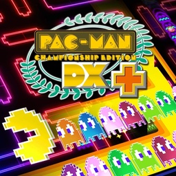

<div align=center>



</div>
<h1 align=center>PAC-MAN Championship Edition DX — Nintendo Switch port</h1>

A native Nintendo Switch port of the Xbox 360 version of **PAC-MAN Championship Edition DX** (Namco Bandai Games, 2010), with
its downloadable content.

It's not an emulator. The PowerPC code of the game's `default.xex` is statically recompiled to C++ with
[ReXGlue](https://github.com/rexglue/rexglue-sdk) and compiled for the Switch, and the game's Direct3D calls are drawn
directly on the Switch GPU's own API, deko3d, by [reNut](https://github.com/masterspike52/reNut)'s Direct3D-level renderer.

> [!NOTE]
> You need your own copy of the game: the Xbox 360 package (`Content/<profile>/58410A8C/000D0000`). The DLC package
> (`Content/<profile>/58410A8C/00000002`, All-in-One Pack) is optional.

## How to install

1. Open the installer page: **https://chanseyisthebest.github.io/pacman-nx-installer/**
2. Choose your game: its **package** (you can choose the DLC package along with it) or a **folder** you extracted the game
   into. Then press **Create pacman-nx.zip**. Everything runs in your browser and the game files never leave your computer:
   the page checks your copy, downloads the build and makes the shaders from your game's own files.
3. Extract the downloaded `pacman-nx.zip` into `sdmc:/switch/`.

Your `pacman-nx` folder should look like this:

```text
/switch/pacman-nx/
  pacman-nx.nro
  LICENSES.txt
  pacman.toml               (your settings; written at the first start when it is missing)
  deko3d_glsl.bin           (the game's shaders, made from your copy)
  game_root/                (the game's files)
  dlc/                      (optional: the DLC package, installed by the game at its first start)
```

The game adds `deko3d_shaders.bin` and `pipeline_list.bin` there as you play (the shaders compiled for the Switch GPU, and
the list of what it drew, so later sessions prepare it ahead).

Launch it with a game override (hold **R** while starting an installed title) or a forwarder. Album applet mode does not
give the game enough memory. If you use a forwarder, set it to a **39-bit address space**.

To build everything yourself instead, see [docs/building.md](docs/building.md).

> [!NOTE]
> **Updating:** open the installer page again and press **Create pacman-nx-update.zip**. It only holds the new
> `pacman-nx.nro` and the shaders, so there is no need to copy the game again: extract it over your folder. Your
> `pacman.toml`, your saves and the game files stay.

> [!CAUTION]
> **The first start** takes longer if you added the DLC (about 45 s on the console): the game installs it then, once.
> **The first time you play** after installing or updating, the game compiles its shaders for the Switch GPU as it meets
> them, so **it can stutter for a moment** on new screens. They are saved next to the NRO and later sessions start smoothly.

## Controls

By default the face buttons work **by position, as on the Xbox 360 pad** the game was made for: the bottom button is the
Xbox's A, the right one is the Xbox's B, and so on.

<div align="center">

| Switch | Xbox 360 |
| --- | --- |
| B (bottom) | A |
| A (right) | B |
| Y (left) | X |
| X (top) | Y |
| ZR / ZL | RT / LT |
| R / L | RB / LB |
| + | Start |
| − | Back |
| Sticks / D-pad | Sticks / D-pad |

</div>

To use the buttons by letter instead (the Switch's A acts as A), set `input_xbox_layout = false` in `pacman.toml`.

## Settings

`pacman.toml`, next to the NRO, holds only your options. Everything else is built into the NRO.

<div align="center">

| Setting | Default | What it does |
| --- | --- | --- |
| `language` | `"auto"` | The Switch's language; or `english`, `japanese`, `french`, `german`, `spanish`, `italian`, `schinese`, `tchinese` |
| `input_xbox_layout` | `true` | Face buttons by position, as on an Xbox pad; `false` = by letter |
| `input_joycon_sideways` | `true` | Single Joy-Cons held sideways, one per player |
| `input_joycon_sideways_stick` | `true` | The single Joy-Con's stick turned for the sideways grip |
| `[input_p1]` | | Button mapping: the Switch buttons that press each Xbox button, e.g. `a = "B, ZR"` |

</div>

If you delete `pacman.toml`, the game writes the default one again at the next start.

## Performance

The port runs at the console's stock clocks on three cores, 720 lines in handheld and 1080 docked. Measured on the console
in handheld, gameplay holds 60 fps with **16.6 ms from reading the controller to the picture**, a single refresh of the
display (64 ms before its frame pacing). Docked at 1080 lines was not measured on a console before release. The
measurements and how each was made are in [docs/pacman-notes.md](docs/pacman-notes.md).

## How it works

- **The game's code is translated, not emulated.** [ReXGlue](https://github.com/rexglue/rexglue-sdk) translates every
  function of the game's program to C++, which is then compiled for the Switch. ReXGlue also gives the game what it
  expects from an Xbox 360: its system, files, audio and controllers.
- **A Direct3D-level renderer on deko3d.** The game's Direct3D calls are replaced by
  [reNut](https://github.com/masterspike52/reNut)'s renderer (as the Banjo-Kazooie: Nuts & Bolts port adapted it), which
  draws them with [plume](https://github.com/renderbag/plume) on [deko3d](https://github.com/devkitPro/deko3d), the Switch
  GPU's own API: no GPU command stream is written or parsed and no EDRAM is modelled.
- **Shaders made from your copy.** 13 of the game's 17 shaders are in `default.xex`. The installer page takes them from your
  copy and makes `deko3d_glsl.bin` in your browser: Renut's [XenosRecomp](https://github.com/hedge-dev/XenosRecomp) translates
  each one to HLSL, DXC compiles it to SPIR-V, [SPIRV-Cross](https://github.com/KhronosGroup/SPIRV-Cross) turns that into GLSL
  and banjo-nx's passes trim it. The game makes the other 4, small interface shaders, at run time with its own shader
  compiler, so they are in none of its files; those 4 are built into the NRO. The console compiles each shader with
  [uam](https://github.com/devkitPro/uam) the first time it is used and keeps the result.
- **The display starts each frame.** As [futari-nx](https://github.com/ChanseyIsTheBest/futari-nx) does, the game's frames
  start from the display's refresh, with two swapchain images, so no frame queues behind another.
- **Machine-optimised functions.** 5,649 of the game's functions run as optimised machine copies
  (`tools/localize_native.py`); those reached under test were compared with the generated originals, call by call.

## Documentation

<div align="center">

| Document | What it explains |
| --- | --- |
| [docs/building.md](docs/building.md) | How to build the PC test build, the NRO and the shader files |
| [docs/pacman-notes.md](docs/pacman-notes.md) | The port step by step: findings in the game's code, every measurement and how it was checked |
| [docs/optimising-functions.md](docs/optimising-functions.md) | How the game's functions are made faster |
| [docs/progress-log.md](docs/progress-log.md) | The work in order |

</div>

## Build

Windows, LLVM clang and the VS Build Tools for the PC build; devkitA64, libnx and deko3d from
[devkitPro](https://devkitpro.org) for the Switch; Python; and your own copy of the game for the code generator and the
shaders. The whole process is in [docs/building.md](docs/building.md).

<div align="center">

| Folder | Contents |
| --- | --- |
| `app/` | The game: hooks, renderer, settings, CMake project |
| `sdk/` | ReXGlue SDK with the Horizon layer and the code generator changes |
| `tools/` | Code generation steps, build and test scripts, shader tools, analysis tools |
| `dist/` | The settings of the test builds |
| `docs/` | Documentation |

</div>

## Credits

- **Namco Bandai Games** — creators of PAC-MAN Championship Edition DX. This is an unofficial, fan-made port with no
  affiliation.
- **ChanseyIsTheBest** — this port.
- **[Tom Clay](https://github.com/rexglue/rexglue-sdk)** — the ReXGlue SDK, built on the work of the
  **[Xenia](https://xenia.jp)** team.
- **[StevensND](https://github.com/StevensND/nfsmw-nx)** — nfsmw-nx: the Switch layer of the SDK and much of the method;
  and [nfsmw-nx-installer](https://github.com/StevensND/nfsmw-nx-installer), which the installer page is built on.
- **[nebadasSwifty](https://github.com/nebadasSwifty/masseffect-nx)** — masseffect-nx.
- **[hedge-dev](https://github.com/hedge-dev/XenosRecomp)** — XenosRecomp, the Xenos shader translator.
- **reNut and [masterspike52](https://github.com/masterspike52/reNut)** — reNut's Direct3D-level renderer (reused with its
  author's permission).
- **[plume](https://github.com/renderbag/plume)** (from UnleashedRecomp), **[deko3d](https://github.com/devkitPro/deko3d)**
  and **[uam](https://github.com/devkitPro/uam)** by fincs, with SwitchWakerHD's uam patches.
- **[devkitPro](https://devkitpro.org) and [switchbrew](https://github.com/switchbrew/libnx)** — devkitA64 and libnx.
- The sibling ports: [katamari-nx](https://github.com/ChanseyIsTheBest/katamari-nx), this port's base;
  [renut-nx](https://github.com/ChanseyIsTheBest/renut-nx), [sa2-nx](https://github.com/ChanseyIsTheBest/sa2-nx),
  [futari-nx](https://github.com/ChanseyIsTheBest/futari-nx), NetherSX2_nx, battd_nx, and the bejeweled3-nx and zuma ports,
  which share their fixes with this one.
- **[KhronosGroup](https://github.com/KhronosGroup/SPIRV-Cross)** — SPIRV-Cross.
- The other libraries listed in [THIRD_PARTY_NOTICES.md](THIRD_PARTY_NOTICES.md).

## Legal

No affiliation with Bandai Namco, Microsoft or Nintendo. "PAC-MAN" is a trademark of Bandai Namco Entertainment Inc.; the
icon is the game's artwork. This repository contains no game files and no code generated from the game. Users must provide
their own legally obtained copy. The released NRO holds the game's recompiled code but none of its data files, and everything
else made from your copy is made on your own computer. Running homebrew requires custom firmware, which violates Nintendo's
ToS and can get a console banned — your call.

Source code is provided under the GPL-3.0 License (see [LICENSE](LICENSE)), like the ports it builds on. The SDK keeps its
BSD-3-Clause license (see [THIRD_PARTY_NOTICES.md](THIRD_PARTY_NOTICES.md)).
